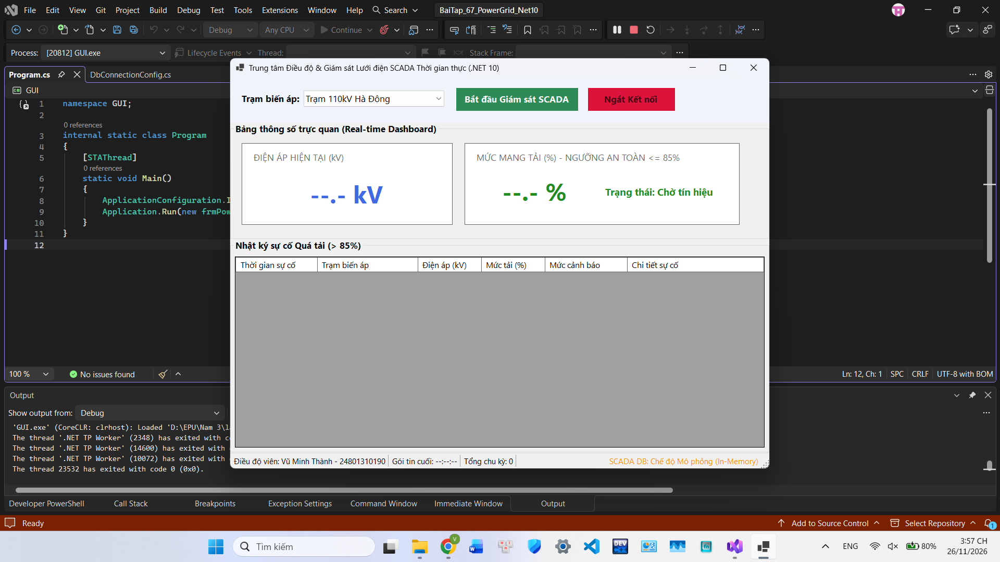
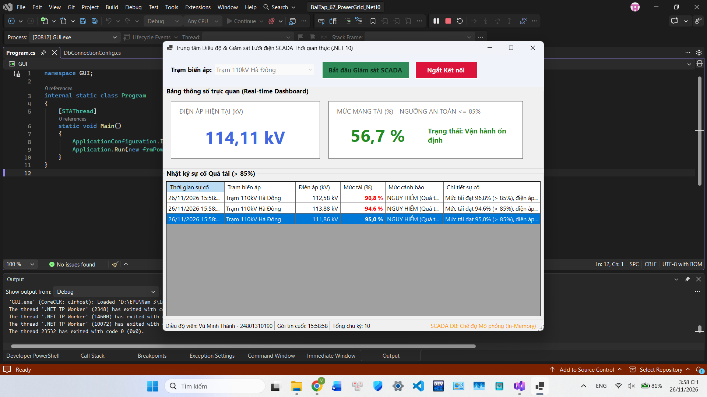
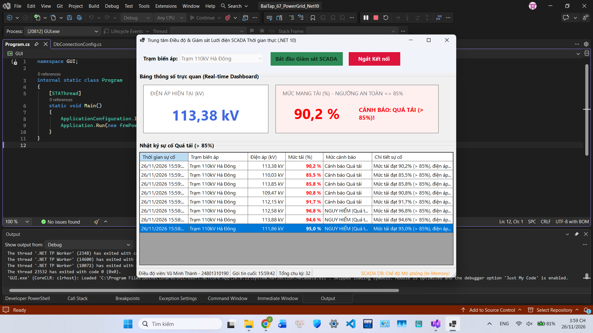
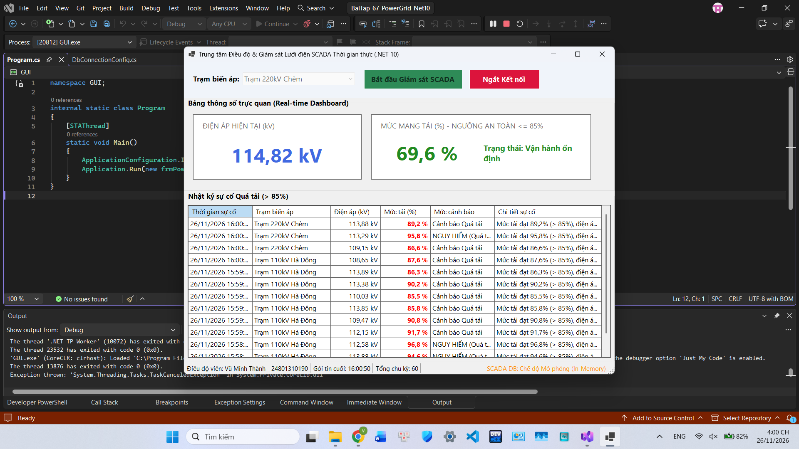
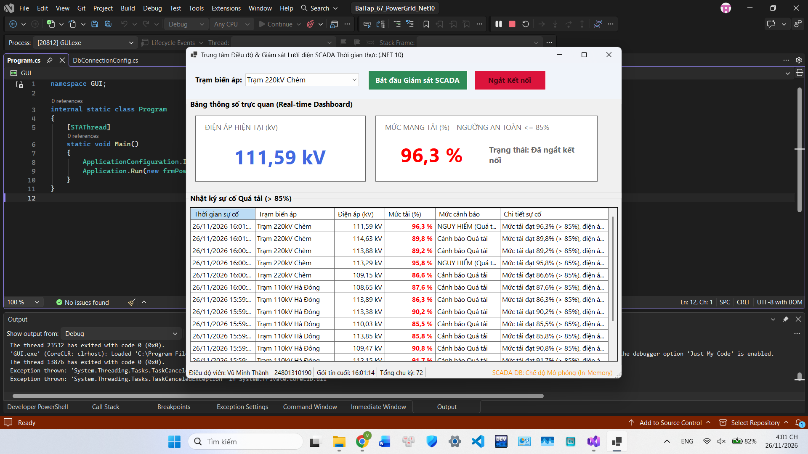

# BÀI TẬP 6.7: TRUNG TÂM ĐIỀU ĐỘ & GIÁM SÁT LƯỚI ĐIỆN THỜI GIAN THỰC (.NET 10)

Ứng dụng Windows Forms mô phỏng hệ thống **SCADA** theo kiến trúc **3-Tier (DTO – DAL – BUS – GUI)**, chạy vòng lặp thu thập dữ liệu ngầm (`Task.Run` định kỳ 2 giây/lần) và tuân thủ nghiêm ngặt **Cross-Thread Safety** (`InvokeRequired` + `this.Invoke`).

## Thông tin sinh viên
- **Họ và tên:** Vũ Minh Thành
- **Mã sinh viên (MSV):** `24810310190`
- **Môn học:** Lập trình .NET (WinForms — Kiến trúc 3-Tier)


## 1. Cấu trúc thư mục
```text
BaiTap_67_PowerGrid_Net10/
├── BaiTap_67_PowerGrid_Net10.sln
├── Database/
│   └── ScriptDB.sql          # Script SQL Server tạo CSDL PowerGridScadaDB
├── DTO/                      # Các lớp đối tượng truyền dữ liệu (net10.0)
├── DAL/                      # Truy xuất LocalDB/SQL Server + Fallback In-Memory (net10.0)
├── BUS/                      # Xử lý nghiệp vụ sinh thông số SCADA & ghi log quá tải (net10.0)
├── GUI/                      # WinForms frmPowerGridMonitor (net10.0-windows)
├── Screenshots/              # Lưu 5 ảnh chụp màn hình chức năng
└── README.md
```

## 2. Hướng dẫn cài đặt & chạy thử
1. Giải nén và mở file **`BaiTap_67_PowerGrid_Net10.sln`** bằng Visual Studio (.NET 10 SDK).
2. *(Tùy chọn Database)* Mở **View → SQL Server Object Explorer**, kết nối `(localdb)\MSSQLLocalDB` → **New Query** → chạy nội dung file `Database/ScriptDB.sql` để tạo `PowerGridScadaDB`. *(Nếu chưa tạo DB, ứng dụng tự động chạy ở chế độ mô phỏng In-Memory).*
3. Chuột phải vào project **`GUI`** → chọn **Set as Startup Project** → nhấn **F5** (Debug mode).

## 3. Ảnh chụp màn hình chức năng (5 ảnh)

### Ảnh 1: Giao diện khởi động `frmPowerGridMonitor` & chọn Trạm biến áp


### Ảnh 2: Trạng thái vận hành ổn định (Mức tải <= 85%, chữ màu Xanh lá)


### Ảnh 3: Trạng thái Cảnh báo Quá tải (> 85%, chữ màu Đỏ & ghi log DataGridView)


### Ảnh 4: Chuyển đổi giám sát Trạm biến áp khác (`Trạm 220kV Chèm`) & tích lũy chu kỳ


### Ảnh 5: Ngắt kết nối SCADA an toàn & Nhật ký sự cố trên `dgvGridLogs`

